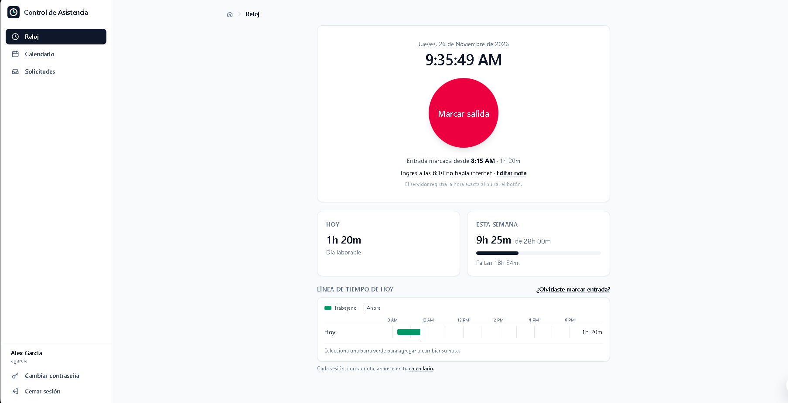

<h1 align="center">Control de Asistencia</h1>

<p align="center">
  Sistema autohospedado de control de asistencia y cumplimiento laboral colombiano.<br>
  Marcación simple para empleados, cálculo automático de recargos y horas extras, reporte Art. 12 Ley 2466 e integración con ERP.
</p>

<p align="center">
  
  
  
  
  
  
</p>

<p align="center">
  
  
</p>

## Por qué existe

Las suites tradicionales de recursos humanos mezclan nómina, selección y reglamentos internos complejos. Este proyecto se enfoca en el flujo operativo y legal de asistencia en Colombia: **recolección de marcaciones → cálculo de jornada, recargos y horas extras → exportación e integración con el ERP de nómina**.

- **Para empleados:** inician sesión y pulsan un único botón para marcar entrada o salida (en formato de 12 horas y zona horaria `America/Bogota`). No pueden alterar la hora del servidor.
- **Para administración:** visualiza quién está en turno en tiempo real, aprueba solicitudes de tiempo faltante y permisos, configura jornadas (hasta 42 h semanales con distribución diaria flexible), consulta la vista previa de recargos/extras y exporta reportes legales y archivos para nómina.
- **Integración ERP incluida:** exportación en Excel (`.xlsx`) y CSV, API REST JSON autenticada y vistas SQL directas.

---

## Funcionalidades principales

### Para empleados
- **Reloj en vivo:** un solo botón para marcar entrada y salida; el servidor registra la hora exacta en UTC y la muestra en hora de Bogotá (12 h).
- **Resumen del día y la semana:** horas trabajadas hoy y progreso frente a la meta semanal.
- **Calendario mensual y línea de tiempo:** estado diario (presente, ausente, permiso, festivo, día libre o sin salida) y descansos entre tramos.
- **Solicitudes:** tiempo faltante (entrada/salida olvidada con motivo) y permisos/ausencias con saldo anual visible.
- **Notas de trabajo:** anotación opcional por cada tramo trabajado, visible para el administrador y en exportaciones.
- **PWA instalable:** se puede agregar a la pantalla de inicio en Android/iOS (requiere HTTPS).

### Para administración
- **Hoy:** tablero en tiempo real con línea de tiempo de quienes están en turno.
- **Asistencia (Por semana, Por mes, Recargos y extras):**
  - Seguimiento semanal y mensual frente a la meta, con exportación CSV y resumen mensual imprimible.
  - **Vista previa de recargos y horas extras:** desglose por empleado y por día en 8 conceptos (ordinaria diurna, recargo nocturno, ordinaria dominical/festiva diurna y nocturna, extra diurna, extra nocturna, extra dominical/festiva diurna y nocturna), más permisos y alertas.
- **Cumplimiento laboral colombiano (CST y Ley 2466 de 2025):**
  - **Identificación y contrato:** cada empleado cuenta con número de documento/cédula (único) y tipo de contrato (término indefinido, fijo, obra o labor, aprendizaje, exento/dirección, tiempo parcial).
  - **Jornadas configurables (≤ 42 h):** soporta jornadas de 42 h o menores (40 h, 38 h, etc.) y **distribución diaria irregular** personalizada (entre 4 y 9 horas por día laborable).
  - **Regla combinada diaria + semanal (Art. 159 CST):** reconoce el exceso sobre la jornada diaria pactada y controla el límite semanal sin contar dos veces una misma hora.
  - **Separación de recargos (Art. 179–181 CST):** clasifica de forma independiente si la hora es ordinaria o extra, diurna o nocturna (`19:00`–`06:00`), y si corresponde a día normal o dominical/festivo.
  - **Alertas sin bloqueo:** señala cuando se superan las **2 horas extras diarias** o **12 horas extras semanales**, sin detener el cálculo ni la exportación al ERP.
  - **Reglas laborales versionadas (`/manage/labor-rules/`):** parámetros editables por fecha de vigencia (jornada máxima semanal, mínima/máxima diaria, franja nocturna, porcentajes de recargos y límites de alerta).
  - **Reporte Art. 12 Ley 2466:** exportación dedicada en **Excel (`.xlsx`)** (con hoja de detalle diario y hoja de resumen por empleado) y **CSV**.
- **Festivos de Colombia:** generador integrado con festivos fijos, traslados por Ley Emiliani y Semana Santa para 2026 y años siguientes.
- **Bandeja de solicitudes, correcciones con historial, "¿Sigues trabajando?" y correo SMTP:** flujo completo de auditoría donde los cambios manuales conservan el registro anterior.

---

## Instalación y puesta en marcha

### Requisitos
- **Python 3.10 o superior** (probado con Python 3.12 / 3.15 y Django 5.2).
- **Git** (opcional, para clonar el repositorio).
- **Node.js** (solo si deseas recompilar los estilos Tailwind CSS; los estilos compilados ya vienen incluidos).

### 1. Ejecución local (desarrollo / pruebas con SQLite)

```bash
# 1. Clonar o ubicarse en la carpeta del proyecto
cd attendance-tool

# 2. Crear y activar entorno virtual
python -m venv .venv
# En Windows (PowerShell):
.venv\Scripts\Activate.ps1
# En Linux / macOS:
# source .venv/bin/activate

# 3. Instalar dependencias (incluye Django, openpyxl, psycopg, etc.)
pip install -r requirements.txt

# 4. Crear archivo de configuración local
copy .env.example .env    # en Linux/macOS: cp .env.example .env
# Edita .env y asegúrate de tener DEBUG=true y un SECRET_KEY (o deja DEBUG=true para pruebas locales)

# 5. Aplicar migraciones (crea tablas, regla laboral inicial, festivos de Colombia y vistas SQL)
python manage.py migrate

# 6. Crear usuario administrador inicial
python manage.py createsuperuser

# 7. Iniciar servidor local
python manage.py runserver
```

Abre `http://127.0.0.1:8000` en tu navegador e inicia sesión con el administrador creado.

> **Importante:** la base de datos SQLite se guarda en `data/db.sqlite3`. Los administradores gestionan el sistema y no marcan entrada ni salida; para probar el reloj de marcación, crea un empleado (sin marcar "Administrador") desde **Empleados → Agregar empleado**, asígnale un horario y usa el botón **Entrar como** o inicia sesión con su usuario.

### 2. Despliegue con Docker

```bash
cp .env.example .env
# Completa SECRET_KEY, ALLOWED_HOSTS, ADMIN_USERNAME y ADMIN_PASSWORD en .env
docker compose up -d --build
```

La aplicación queda escuchando en el puerto `8000` con SQLite persistido en el volumen `attendance_data`. Detrás de un proxy inverso HTTPS (Nginx, Caddy o Traefik), activa `HTTPS=true` y `CSRF_TRUSTED_ORIGINS`.

### 3. Con PostgreSQL

Define `POSTGRES_PASSWORD` en `.env` y ejecuta:

```bash
docker compose -f docker-compose.yml -f docker-compose.postgres.yml up -d --build
```

O apunta `DATABASE_URL` en `.env` a una instancia PostgreSQL existente. *(Nota: revisa la sección de vistas SQL en `TODO.md` antes de migrar las vistas a PostgreSQL).*

---

## Guía de uso rápida

1. **Configurar reglas laborales (opcional, ya viene preconfigurada):**
   - Ve a **Asistencia → Recargos y extras → Reglas laborales** (o `/manage/labor-rules/`) para revisar la vigencia inicial (`2024-07-15`, 42 h/semana, nocturno `7:00 PM`–`6:00 AM`, recargos 35%, 90%, 25%, 75%, 115%, 165%).
2. **Crear horarios:**
   - Ve a **Horarios → Agregar horario**. Define las horas semanales (p. ej. `42`, `40` o `38`) y los días laborables.
   - Si el horario tiene **distribución diaria irregular** (p. ej. 9 h de lunes a jueves y 6 h el viernes), ingresa las horas específicas de cada día; el sistema valida que estén entre la jornada mínima y máxima diaria y que sumen exactamente las horas semanales.
3. **Crear empleados:**
   - Ve a **Empleados → Agregar empleado**. Registra **Cédula / Documento**, nombre, usuario, **Tipo de contrato**, horario y fecha de inicio.
4. **Registro diario del empleado:**
   - El empleado inicia sesión y en **Reloj** pulsa **Marcar entrada** al iniciar, puede pausar/salir en descansos y pulsa **Marcar salida** al terminar. Cada marcación cerrada actualiza automáticamente su desglose diario y semanal.
5. **Revisión, vista previa y exportaciones:**
   - En **Asistencia → Recargos y extras**, filtra por rango de fechas o empleado para ver horas ordinarias, recargos, extras y alertas.
   - Descarga desde los botones superiores:
     - **Art. 12 (.xlsx)** / **Art. 12 (.csv)**: reporte detallado de trabajo suplementario conforme al Art. 12 de la Ley 2466.
     - **ERP (.xlsx)** / **ERP (.csv)**: archivo plano para importación en nómina.

---

## Integración con ERP

El aplicativo ofrece tres mecanismos de integración que leen exactamente las mismas tablas calculadas (`DailyAttendanceSummary` y `TimeEntryBreakdown`):

### 1. Archivos Excel (`.xlsx`) y CSV
Disponibles desde **Asistencia → Recargos y extras**:
- `/manage/attendance/erp.xlsx` y `/manage/attendance/erp.csv`
- `/manage/attendance/art12.xlsx` y `/manage/attendance/art12.csv`

### 2. API REST JSON
- `GET /api/v1/erp/summary/?start=YYYY-MM-DD&end=YYYY-MM-DD&employee_id=&document_number=`
- `GET /api/v1/erp/entries/?start=YYYY-MM-DD&end=YYYY-MM-DD&employee_id=&document_number=`

**Autenticación:** mediante sesión de usuario administrador (`is_staff=True`) o enviando el token configurado en `ERP_API_TOKEN`:

```bash
curl -H "Authorization: Bearer TU_TOKEN_ERP" \
  "http://127.0.0.1:8000/api/v1/erp/summary/?start=2026-11-01&end=2026-11-30"
```

También acepta el encabezado `X-API-Key: TU_TOKEN_ERP`.

### 3. Vistas SQL directas (SQLite)
La migración `0013_erp_sql_views` crea dos vistas listas para consulta directa desde conectores ODBC/SQLite del ERP:
- `v_erp_resumen_diario`: resumen por empleado y fecha con cédula, usuario, tipo de contrato, festivo/domingo, minutos y horas decimales de cada una de las 8 cubetas, permisos y banderas de alerta.
- `v_erp_desglose_marcaciones`: detalle por cada marcación individual (`TimeEntry`) con entrada/salida UTC, origen, minutos/horas por concepto, nota y memo.

---

## Variables de entorno (`.env`)

| Variable | Por defecto | Descripción |
|---|---|---|
| `SECRET_KEY` | ninguno | Obligatorio si `DEBUG=false`. |
| `DEBUG` | `false` | Modo desarrollo (`true` solo en local). |
| `ALLOWED_HOSTS` | `localhost,127.0.0.1,[::1]` | Hosts permitidos separados por coma. |
| `CSRF_TRUSTED_ORIGINS` | vacío | Orígenes HTTPS permitidos (ej. `https://asistencia.empresa.com`). |
| `HTTPS` | `false` | Cookies seguras detrás de proxy inverso HTTPS. |
| `TIME_ZONE` | `America/Bogota` | Zona horaria de la empresa. |
| `DAY_ROLLOVER_HOUR` | `0` | Hora de corte del día laboral (`0` = medianoche). |
| `DATABASE_URL` | vacío | Vacío usa SQLite (`data/db.sqlite3`). Para Postgres: `postgres://...`. |
| `ERP_API_TOKEN` | vacío | Token Bearer / `X-API-Key` para consumir `/api/v1/erp/*`. |
| `EMAIL_HOST`, `EMAIL_PORT`, `EMAIL_HOST_USER`, `EMAIL_HOST_PASSWORD`, `EMAIL_USE_SSL`, `EMAIL_FROM` | vacío | Configuración SMTP opcional para notificaciones. |
| `ADMIN_USERNAME`, `ADMIN_PASSWORD` | vacío | Solo Docker: crea el administrador inicial si no existe ninguno. |

---

## Estructura del proyecto

```text
attendance/
  models.py          modelos (Employee con cédula/contrato, ScheduleVersion, LaborRuleConfig, TimeEntryBreakdown, DailyAttendanceSummary)
  labor.py           motor de cálculo laboral colombiano (regla combinada, 8 cubetas, alertas y sincronización)
  erp.py             generación de reportes Art. 12 Ley 2466, exportación ERP (.xlsx/.csv) y serialización
  api_views.py       endpoints REST JSON (/api/v1/erp/summary/ y /api/v1/erp/entries/)
  services.py        reglas de marcación, horarios, metas, solicitudes y correcciones
  views.py           vistas del portal del empleado
  manage_views.py    vistas del panel de administración
  forms.py           formularios y validaciones (incluye horas diarias y reglas laborales)
  navigation.py      menú lateral y migas de pan
  co_holidays.py     festivos de Colombia (fijos, Ley Emiliani y Semana Santa)
  lockout.py         bloqueo temporal por intentos fallidos
  notifications.py   envío de correos SMTP
  templates/         plantillas HTML en español
  migrations/        migraciones de esquema, festivos de Colombia, regla inicial y vistas SQL
  tests.py           pruebas generales de asistencia, vistas y reglas
  tests_labor.py     pruebas unitarias del motor laboral colombiano
  tests_erp.py       pruebas de reportes Art. 12, Excel/CSV, API REST y vistas SQL
config/              configuración Django y enrutamiento raíz
assets/              fuentes Tailwind CSS y generador de iconos
```

---

## Pruebas automatizadas

Ejecuta la suite completa (152 pruebas entre lógica de asistencia, motor laboral, exportaciones Excel/CSV, API REST y vistas SQL):

```bash
python manage.py test
```

Si editas plantillas HTML y necesitas recompilar Tailwind CSS:

```bash
npm install
npm run css:build
```

## Licencia

Publicado bajo la [Licencia MIT](LICENSE).
